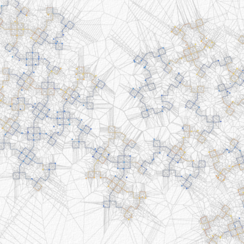

# Un article vachement bien

## Introduction (lorem)

**Lorem ipsum dolor sit amet**, consectetur adipiscing elit. Nulla volutpat porttitor turpis at ornare. Sed et risus sed nisi semper consequat ac sed est. Praesent dui turpis, cursus sed tincidunt vitae, faucibus ut leo.  

_Vestibulum eleifend_, nisl eu porta lobortis, diam tortor viverra massa, ut ultricies diam eros ac nulla. 

**_In ultricies nisi nisl_**, in lacinia neque gravida et. Vestibulum rutrum diam quis diam porttitor cursus. Phasellus nec mollis mauris. Nunc lacinia turpis et lorem laoreet aliquet. 

Lorem ipsum dolor sit amet, consectetur adipiscing elit. Nulla volutpat porttitor turpis at ornare. Sed et risus sed nisi semper consequat ac sed est. Praesent dui turpis, cursus sed tincidunt vitae, faucibus ut leo. Suspendisse consectetur, nisl vitae fermentum venenatis, mi sem accumsan diam, nec interdum dolor purus eget ligula. 

Lorem ipsum dolor sit amet, consectetur adipiscing elit. Nulla volutpat porttitor turpis at ornare. Sed et risus sed nisi semper consequat ac sed est. Praesent dui turpis, cursus sed tincidunt vitae, faucibus ut leo. Suspendisse consectetur, nisl vitae fermentum venenatis, mi sem accumsan diam, nec interdum dolor purus eget ligula. 

Lorem ipsum dolor sit amet, consectetur adipiscing elit. Nulla volutpat porttitor turpis at ornare. Sed et risus sed nisi semper consequat ac sed est. Praesent dui turpis, cursus sed tincidunt vitae, faucibus ut leo. Suspendisse consectetur, nisl vitae fermentum venenatis, mi sem accumsan diam, nec interdum dolor purus eget ligula. 

Lorem ipsum dolor sit amet, consectetur adipiscing elit. Nulla volutpat porttitor turpis at ornare. Sed et risus sed nisi semper consequat ac sed est. Praesent dui turpis, cursus sed tincidunt vitae, faucibus ut leo. Suspendisse consectetur, nisl vitae fermentum venenatis, mi sem accumsan diam, nec interdum dolor purus eget ligula. 

Lorem ipsum dolor sit amet, consectetur adipiscing elit. Nulla volutpat porttitor turpis at ornare. Sed et risus sed nisi semper consequat ac sed est. Praesent dui turpis, cursus sed tincidunt vitae, faucibus ut leo. Suspendisse consectetur, nisl vitae fermentum venenatis, mi sem accumsan diam, nec interdum dolor purus eget ligula. 

Lorem ipsum dolor sit amet, consectetur adipiscing elit. Nulla volutpat porttitor turpis at ornare. Sed et risus sed nisi semper consequat ac sed est. Praesent dui turpis, cursus sed tincidunt vitae, faucibus ut leo. Suspendisse consectetur, nisl vitae fermentum venenatis, mi sem accumsan diam, nec interdum dolor purus eget ligula. 

## La duodécimale (tableau)

> *ah, la duodécimale et le cercle*

J'ai donc mes 12 teintes de base, pour limiter les caractères de mon alphabet, je choisis d'utiliser le symbole `#` pour noter une progression de 30°.

J'obtiens ainsi un alphabet de 7 caractères (`R`, `V`, `J`, `C`, `B`, `M`, `#`) pour couvrir mes 12 teintes fondamentales :

| Code HSV             | Nom de la couleur | Abréviation |
| -------------------- | ----------------- | ----------- |
| `(0°, 100%, 100%)`   | Rouge             | `R`         |
| `(30°, 100%, 100%)`  | Rouge-Orange      | `R#`        |
| `(60°, 100%, 100%)`  | Jaune             | `J`         |
| `(90°, 100%, 100%)`  | Chartreuse        | `J#`        |
| `(120°, 100%, 100%)` | Vert              | `V`         |
| `(150°, 100%, 100%)` | Menthe            | `V#`        |
| `(180°, 100%, 100%)` | Cyan              | `C`         |
| `(210°, 100%, 100%)` | Azur              | `C#`        |
| `(240°, 100%, 100%)` | Bleu              | `B`         |
| `(270°, 100%, 100%)` | Indigo            | `B#`        |
| `(300°, 100%, 100%)` | Magenta           | `M`         |
| `(330°, 100%, 100%)` | Fuchsia           | `M#`        |


## Résultat (image)

Lorem ipsum dolor sit amet, consectetur adipiscing elit. Nulla volutpat porttitor turpis at ornare. Sed et risus sed nisi semper consequat ac sed est. Praesent dui turpis, cursus sed tincidunt vitae, faucibus ut leo. Suspendisse consectetur, nisl vitae fermentum venenatis, mi sem accumsan diam, nec interdum dolor purus eget ligula. 




## La grammaire (fence)

Lorem ipsum dolor sit amet, consectetur adipiscing elit. Nulla volutpat porttitor turpis at ornare. Sed et risus sed nisi semper consequat ac sed est. Praesent dui turpis, cursus sed tincidunt vitae, faucibus ut leo. Suspendisse consectetur, nisl vitae fermentum venenatis, mi sem accumsan diam, nec interdum dolor purus eget ligula. 

Arbre proposé par Alexandre Villares [https://github.com/villares/sketch-a-day/tree/main/2026/sketch_2026_09_25](https://github.com/villares/sketch-a-day/tree/main/2026/sketch_2026_09_25)

```
{ 
  "name":"villares1",
  "grammaire": 
  { 
    "axiom": "Y",
    "rules": {
      "X": "[-FY][+FY]FY",
      "Y": "YF[+XFB][-XFB]X",
      "F": "[-F+FA]FF"
  },  
  "iterations":7,
  "angle":45
}
```

# la gravité (LaTex)

$$F = G \frac{m_1 m_2}{r^2}$$

où $G$ représente la constante gravitationnelle. 


**Je m'en doutais LaTex ne passe pas, je m'en fous,  je ne fais pas de Latex faut arrêter de déconner avec ça maintenant ! 2026, Troisième millénaire tout ça !**


**Une solution de contournement serait de placer le Latext dans un fence et de travailler un parsing spécifique soit dans jsomdiy.py ou déléguer ça dans le template typ**

**Mais moi je touche pas à ça !**

```latex
$$F = G \frac{m_1 m_2}{r^2}$$

où $G$ représente la constante gravitationnelle. 
```

## Sources (liste)

* Minor Planet Center (2026): MPEC 2026-U85, 2026 ED138. https://minorplanetcenter.net/mpec/K26/K26U85.html
* JPL Horizons System, 2026 ED138, orbit solution JPL#2. https://ssd.jpl.nasa.gov/horizons/
* Bowell, Hapke, Domingue et al. (1989): Application of photometric models to asteroids. In: Asteroids II, University of Arizona Press, 524–556.
* NASA NSSDC: Pluto Fact Sheet. https://nssdc.gsfc.nasa.gov/planetary/factsheet/plutofact.html
